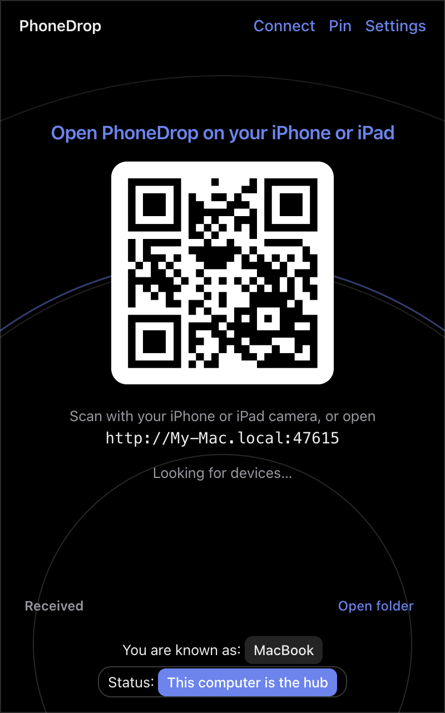
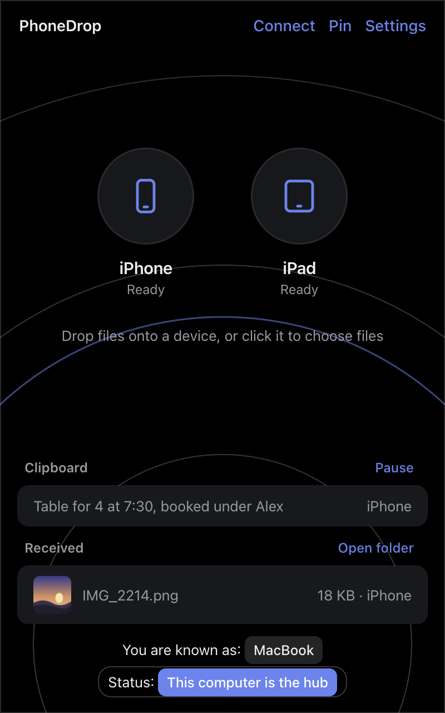

<p align="center">
  
</p>

<p align="center">
  <a href="https://github.com/ImSammyTTV/phonedrop/releases/latest"></a>
  <a href="https://github.com/ImSammyTTV/phonedrop/releases"></a>
  
  <a href="LICENSE"></a>
</p>

<p align="center">
  <b>PhoneDrop</b> is an AirDrop-style app for your Mac and PC. Send photos, videos and files between your iPhone, iPad and computers,<br>
  and copy on one device to paste on another. Over your own Wi-Fi at home, and over Tailscale when you're away.
</p>

<p align="center">
  <a href="https://github.com/ImSammyTTV/phonedrop/releases/latest"><b>⬇️ Download</b></a> ·
  <a href="#-quick-start"><b>🚀 Quick start</b></a> ·
  <a href="#-how-to-use-it"><b>📲 Using it</b></a> ·
  <a href="#-help"><b>❓ Help</b></a> ·
  <a href="#%EF%B8%8F-build-from-source"><b>🛠️ Build</b></a> ·
  <a href="https://github.com/ImSammyTTV/phonedrop/issues/new"><b>🐛 Report a bug</b></a>
</p>

---

## ✨ Features

<table>
<tr>
<td width="50%" valign="top">

### 📲 No app to install
Your **iPhone or iPad** just opens a web page in Safari. Scan the QR code, add it to your home screen, and it works like an app.

</td>
<td width="50%" valign="top">

### ↔️ Files in every direction
Send photos and files **iPhone or iPad → computer** into a folder you choose, or drop files onto a device's **bubble** to send them
to that device. Phones, iPads, Macs and PCs can all send to each other.

</td>
</tr>
<tr>
<td valign="top">

### 📋 Shared clipboard
Copy text or an image on your Mac and paste it on your PC, or the other way round, automatically. On your iPhone or iPad,
tap **Send my clipboard**, or tap something your computer copied to copy it.

</td>
<td valign="top">

### 🌍 At home and away
At home, everything goes straight over your Wi-Fi. If your devices use [Tailscale](https://tailscale.com), PhoneDrop keeps
working when you're out, and switches back to Wi-Fi as soon as you're home.

</td>
</tr>
<tr>
<td valign="top">

### 🔒 Encrypted end to end
Everything is encrypted with a passphrase that never leaves your devices. Only your own devices, on your home network or tailnet,
can connect at all.

</td>
<td valign="top">

### 🫧 Lives in the tray
Click the tray or menu-bar icon and the popup appears, with your devices as bubbles over softly rippling rings. Click away and it
tucks itself back. **Pin** keeps it open while you drag files in. Starts with your computer.

</td>
</tr>
</table>

<table>
<tr>
<td width="50%" align="center">
  <br>
  <sub>Scan to connect</sub>
</td>
<td width="50%" align="center">
  <br>
  <sub>Connected: send, receive, copy and paste</sub>
</td>
</tr>
</table>

> [!NOTE]
> **Private by design.** Files and clipboard go from device to device over your own network. There is no cloud, no account and no
> tracking. PhoneDrop only contacts the internet if you turn on **Check for updates** (or choose *Check for updates…*), and then
> only to ask GitHub whether there's a new version.

---

## 🚀 Quick start

PhoneDrop runs a small **hub** on one of your computers; your other devices connect to it. Pick the computer that's on the most.

1. **Download** from the [latest release](https://github.com/ImSammyTTV/phonedrop/releases/latest):
   `PhoneDrop-…-arm64.dmg` for a Mac (drag it into Applications), or `PhoneDrop-Setup-…exe` for Windows.
2. On the **hub computer**, Settings opens the first time. Leave **This computer is the hub** selected, choose a **passphrase**,
   and click **Save**. Allow it through the firewall if asked (on Windows choose *Private networks*).
3. On your **other computer**, choose **Connect to a hub**, type the hub's address (shown in its Settings, e.g. `My-Mac.local`)
   and the same passphrase.
4. On your **iPhone or iPad**, on the same Wi-Fi, scan the QR code in the popup. The page walks you through a one-time
   certificate install (see below), then tap **Open PhoneDrop**, enter the passphrase, and **Share → Add to Home Screen**.
5. Your devices appear as bubbles. You're connected!

> [!TIP]
> **Why a certificate?** Browsers only allow encryption and clipboard access on secure (HTTPS) pages. PhoneDrop makes its own
> certificate on the hub and your iPhone or iPad trusts it once: *Settings → General → VPN & Device Management* to install it, then
> *Settings → General → About → Certificate Trust Settings* to switch it on. It can only vouch for your home network and tailnet,
> never for real websites.
>
> **Unsigned app warnings:** Windows SmartScreen may say *"Windows protected your PC"*: click **More info → Run anyway**. On a Mac,
> if macOS says the app can't be checked, right-click PhoneDrop in Applications and choose **Open**.

---

## 📲 How to use it

| I want to… | Do this |
|---|---|
| **Send photos from my iPhone or iPad to a computer** | Open PhoneDrop on the device and tap the computer's **bubble**, then pick photos or files. They land in `Pictures/PhoneDrop`. |
| **Send a file from my computer to a device** | Drag it onto that device's **bubble** (or click the bubble to choose files). On a Mac you can also drop files on the menu-bar icon. |
| **Copy on one computer, paste on the other** | Just copy. Text and images sync automatically. Recent ones are under **Clipboard**; click one to copy it again. |
| **Send my iPhone's clipboard** | Copy something, open PhoneDrop, tap **Send my clipboard**. |
| **Copy something from my computer on my iPhone** | Open PhoneDrop and tap it under **Recent**. Images and files have **Save** too. |
| **Stop syncing the clipboard for a while** (e.g. passwords) | Click **Pause** in the popup, or **Pause clipboard sync** in the tray menu. |
| **Use it away from home** | Keep Tailscale on. PhoneDrop switches over by itself; the status shows **Connected over Tailscale**. |
| **See a received photo** | Click it in the *Received* list for a large preview, with a button to show it in its folder. |
| **Change where files are saved** | Click **Connect**, then **Change save folder**. |
| **Change the hub, passphrase or name** | Click **Settings** in the popup. |
| **Get updates** | Turn on **Check for updates automatically** in Settings, or choose **Check for updates…** from the tray menu. On Windows the update downloads by itself and installs when PhoneDrop restarts (or click **Restart to update**). On a Mac, click **Download**, then drag PhoneDrop into Applications. |
| **Turn off start-at-login, open the folder or quit** | Right-click the tray or menu-bar icon. |

---

## 🧭 How it works

```text
 iPhone / iPad (Safari) ─┐                                   ┌─ other Mac or PC (PhoneDrop)
                         ├─►  PhoneDrop hub on one computer ◄─┤
           Wi-Fi at home │     http://<hub>:47615  (setup)    │  Wi-Fi at home
         Tailscale away  │    https://<hub>:47616  (app)      │  Tailscale away
```

The hub runs inside PhoneDrop on one computer. It serves the page for your iPhone and iPad and relays files, clipboard and
"who's online" between your devices. Everything is encrypted (AES-256) on the sending device with a key made from your passphrase,
so the hub only ever handles scrambled data, and it only accepts connections from your home network or your tailnet.

Devices learn the hub's Tailscale address while they're at home. Away from home they connect through Tailscale, and every
30 seconds they check whether Wi-Fi works again. Files wait on the hub (encrypted, up to 100 MB each), so a device that connects
a little later still gets them, until 25 newer items push them out or the hub restarts.

---

## ❓ Help

<details>
<summary><b>My iPhone or iPad can't open the page</b></summary>

- Check both devices are on the **same Wi-Fi** (not a guest network, and not mobile data on the phone) for the first setup.
- Allow PhoneDrop through the firewall: on Windows, *Windows Security → Firewall & network protection → Allow an app through firewall*;
  on a Mac, *System Settings → Network → Firewall → Options*.
- Some routers block devices from talking to each other ("AP isolation" or "client isolation"). Turn that off in your router.
- If the `.local` address doesn't open, use the IP address shown under it in the **Connect** panel.
</details>

<details>
<summary><b>Safari says the connection isn't private</b></summary>

The certificate isn't trusted yet. Open the setup page again (the QR code), install the certificate, and make sure it's switched on in
*Settings → General → About → Certificate Trust Settings*.
</details>

<details>
<summary><b>It doesn't work away from home</b></summary>

- Tailscale has to be connected on the hub and on the device.
- Connect at home once first, so the device can learn the hub's Tailscale address.
- On iPhone and iPad, open PhoneDrop from the home-screen icon (it opens from its saved copy when you're away).
</details>

<details>
<summary><b>My photos are JPEG, not HEIC</b></summary>

That's iOS, not PhoneDrop. Safari can convert photos to JPEG when you pick them. To keep the original HEIC files, in iPhone
*Settings → Photos → Transfer to Mac or PC*, choose **Keep Originals**.
</details>

<details>
<summary><b>HEIC photos have no thumbnail on my PC</b></summary>

Previews come from Windows' own thumbnailer. Install Microsoft's free *HEIF Image Extensions* from the Microsoft Store to preview HEIC.
</details>

<details>
<summary><b>Another program already uses the port</b></summary>

The hub uses ports `47615` and `47616`. If something else has them, close that program, then quit PhoneDrop from the tray menu and
open it again.
</details>

<details>
<summary><b>Upgrading from PhoneDrop 1.x</b></summary>

The Windows installer upgrades 1.x in place and keeps your save folder. Choose a passphrase in Settings the first time, then set up
your iPhone or iPad again from the QR code (2.0 adds encryption, so the old home-screen shortcut needs replacing).
</details>

---

## 🛠️ Build from source

You need [Node.js](https://nodejs.org) (v20 or newer).

```bash
git clone https://github.com/ImSammyTTV/phonedrop.git
cd phonedrop
npm install
npm start                  # run it (shows the popup once; add -- --hidden to start in the tray)
npm run dist:mac           # on a Mac: dist/PhoneDrop-<version>-arm64.dmg
npm run dist:win           # on a Mac: dist/PhoneDrop-Setup-<version>.exe + latest.yml
bash build-installer.sh    # on Windows: dist/PhoneDrop Setup <version>.exe
```

`build-installer.sh` packs the app, stamps the icon with `rcedit`, then wraps it in an NSIS installer. It avoids
`electron-builder`'s code-signing download, which needs symlink privileges on Windows. `npm run icons` regenerates the icons.

**Releasing:** attach `latest.yml`, the `.exe`, its `.blockmap` and the `.dmg` to the GitHub release. Windows installs find
updates through `latest.yml`; Macs read the release list and download the `-arm64.dmg`.

| Path | Purpose |
| --- | --- |
| `main.js` | Electron main process: tray, popup window, settings, starts the hub and sync |
| `preload.cjs` | Bridge between the popup and the main process |
| `renderer/` | The popup on your computer |
| `core/sync.js` | Sync engine: clipboard, files, who's online, Wi-Fi/Tailscale switching |
| `core/clipboard.js` | Reads and writes the computer's clipboard (text and images) |
| `core/updates.js` | Optional update checks (Windows installs automatically; Mac downloads the new version) |
| `server/` | The hub: relay, encrypted file storage, HTTPS certificate, network detection |
| `shared/` | Encryption and connection logic shared by computers and phones |
| `web/` | The page served to your iPhone or iPad |
| `build-installer.sh` | Builds the Windows installer on Windows |

---

## 📄 License

[MIT](LICENSE) © ImSammyTTV. See the [changelog](CHANGELOG.md) for what's new.
